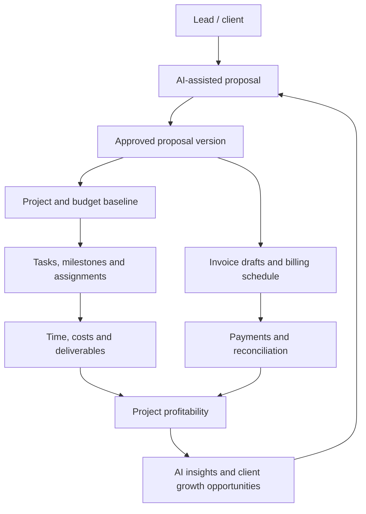

# Güfi OS

> The AI-powered internal operating system for Güfi, a web design and ecommerce agency.

**Official brand:** [gufi.io](https://www.gufi.io/)  
**Infrastructure:** GitHub · Supabase · Vercel  
**Development:** VS Code, Claude Code and Codex  
**Status:** Phase 1 foundation built locally (not yet deployed). See [What's built](#whats-built-phase-1) below; everything else in this README is the product plan.

## What's built (Phase 1)

| Area | Built | Where |
| --- | --- | --- |
| App | Next.js 16.4 App Router, React 19.3, TypeScript, Tailwind CSS 4, Lucide icons | `src/` |
| Sign-in | Supabase Auth: password or emailed link, invitation-only (no public sign-up), invite/reset links, set password | `src/app/sign-in`, `src/app/auth` |
| Access | Organizations, memberships, 5 roles, deny-by-default RLS on every table, audit log | `supabase/migrations/` |
| Workspace | Branded shell, role-aware sidebar, mobile menu, organization switcher, Güfi AI panel (clearly *not connected*) | `src/components/shell`, `src/components/ai` |
| Overview | Live counts of clients and projects, due soon / overdue, honest empty states (no sample numbers) | `src/app/(workspace)/page.tsx` |
| Clients | List, search, filter, create, edit, contacts, duplicate-company protection | `src/app/(workspace)/clients`, `src/features/clients` |
| Projects | List, filters, create, edit, status changes, team assignment | `src/app/(workspace)/projects`, `src/features/projects` |
| Settings | Workspace name, time zone, currency, language; team roster and role reference (admins only) | `src/app/(workspace)/settings` |
| Tests | 36 tests: RLS/security boundary tests on the real migration (in-memory Postgres via PGlite), plus unit tests | `tests/` |

Setup, Supabase/Vercel configuration and admin scripts: **[docs/setup.md](docs/setup.md)**. Brand sources: [docs/brand.md](docs/brand.md). Security model: [docs/security.md](docs/security.md). Decisions log: [docs/decisions.md](docs/decisions.md).

```bash
npm install
cp .env.example .env.local   # fill in Supabase URL + publishable key
npm run dev                  # http://localhost:3000
npm test && npm run lint && npm run typecheck && npm run build
```

## 1. Product vision

Güfi OS is a single workspace for managing the agency from lead acquisition to project delivery, financial reporting and client growth. It replaces disconnected operational workflows with shared client, project, task, financial and marketing records.

The platform should help Güfi sell more, deliver projects profitably, reduce administrative work and proactively identify new opportunities for the agency and its clients. AI is embedded into each workflow, not just exposed as a standalone chatbot.

## 2. Documentation and AI coding agents

| File | Purpose |
| --- | --- |
| `README.md` | Product overview, setup, architecture and contributor onboarding (this file). |
| `AGENTS.md` | Canonical detailed product requirements, security policies, design standards and implementation roadmap shared by coding agents. |
| `CLAUDE.md` | Claude Code instructions; imports `AGENTS.md` so Claude Code and Codex share the same requirements. |

Keep these files in the repository root. Do not maintain conflicting copies of the product specification. Update `AGENTS.md` when product decisions change; update this README when actual setup or architecture changes. If existing files have valuable instructions, merge them instead of overwriting them.

## 3. Product modules

| Module | Scope |
| --- | --- |
| Agency overview | Role-based dashboard: revenue, cash, profit, receivables, project health, sales pipeline, team workload and AI alerts. |
| CRM and clients | Leads, contacts, client profiles, sales pipeline, communications, contracts, technology inventory and upsell opportunities. |
| AI proposal studio | Generate branded editable proposals from briefs, meeting notes, service pricing and approved case studies; revisions, PDF, secure links, acceptance and internal margin estimates. |
| Projects and budgets | Approved scope, milestones, deliverables, deadlines, actual versus budgeted costs, change orders, retainers and forecast profitability. |
| Tasks and team | Trello-style Kanban, drag-and-drop, assignments, priorities, subtasks, comments, files, time tracking and capacity. |
| Invoices and finance | Draft/issued invoices, recurring billing, payment allocation, receivables, expenses, accounts, transactions, payables, reconciliation, P&L and cash forecasts. |
| Calendar | Meetings, task due dates, milestones, invoice deadlines, launches, team availability and authorized Google Calendar synchronization. |
| Marketing | Agency acquisition analytics, paid media, lead attribution, competitive research, AI campaign recommendations and approved execution. |
| Shopify intelligence | Continuous official-source monitoring, release and deprecation analysis, client-store applicability, implementation plans and commercial opportunities. |
| Güfi AI | Contextual assistant with sales, proposals, delivery, finance, marketing, Shopify, team and strategy capabilities. |
| Knowledge and settings | Internal SOPs, templates, case studies, knowledge retrieval, users, permissions, integrations, notifications and audit history. |
| Client portal (later) | Scoped proposal acceptance, invoice payment, project visibility and deliverable approval. |

### Core operational workflow



Use idempotent, transactional workflows for proposal conversion and financial operations. Never expose internal cost estimates to clients. Maintain historical records for accepted proposals, approved budgets and issued invoices.

## 4. Brand and UX

Use [gufi.io](https://www.gufi.io/) as the source of truth for the brand. Retrieve original authorized logo assets and verify fonts and exact color values; do not redraw the logo or invent official tokens. Store approved assets in `public/brand/`. If extraction is blocked, use clearly labeled temporary assets and request original files or the Webflow export.

Design a premium agency workspace with a compact sidebar, strong typography, contextual navigation, elegant proposal layouts, accessible tables, deliberate empty states and a global AI panel. Reference Linear for task interactions, Ramp for financial clarity and Attio for CRM organization; do not copy their brands. Support responsive layouts and keyboard access. English is the proposed default; support future Spanish localization.

## 5. Architecture

GitHub, Supabase and Vercel are confirmed. All other choices below are recommendations until the actual repository is audited.

| Layer | Proposed implementation |
| --- | --- |
| App | Next.js App Router, TypeScript |
| UI | Tailwind CSS, shadcn/ui, Lucide or existing compatible system |
| Data | Supabase PostgreSQL, versioned migrations, generated database types |
| Identity | Supabase Auth, organization membership, role/resource permissions and RLS |
| Files | Private Supabase Storage, scoped signed URLs |
| Hosting | Vercel, preview deployments and protected production |
| AI | Server-side model provider adapters, structured outputs, scoped tool calls; OpenAI API proposed, not mandated by the coding agent choice |
| Retrieval | PostgreSQL full-text search and pgvector where justified |
| Jobs | Protected scheduled triggers and durable, retryable database-backed jobs |
| Integrations | Provider adapters, verified webhooks, sync logs and encrypted credentials where applicable |
| External services | Shopify, Google Ads/GA4/Search Console, Meta, Google Calendar, Gmail/Drive, Stripe and QuickBooks subject to approval and actual requirements |

Prefer a modular monolith, not microservices. Preserve established conventions and working dependencies. Keep authorization and business rules server-side, with a separate domain layer for authoritative calculations.

### Illustrative repository layout

Adapt to the actual project; do not move working files merely to match this example.

```text
gufi-os/
├── README.md
├── AGENTS.md
├── CLAUDE.md
├── src/
│   ├── app/              # routes, layouts, API endpoints and webhooks
│   ├── components/       # UI and shared components
│   ├── features/         # domain-specific queries, services and schemas
│   ├── agents/           # AI orchestration, prompts, tools and policies
│   ├── integrations/     # external provider adapters
│   ├── lib/              # auth, permissions, database, money, validation
│   └── types/
├── public/brand/
├── supabase/
│   ├── migrations/
│   └── tests/
├── docs/
├── tests/
└── .github/workflows/
```

### Data relationships

Organization membership determines access to clients, projects and related records. A client can have proposals, stores, projects, invoices and opportunities. Accepted proposal versions create a project, budget baseline, billing schedule and draft tasks. Project time entries and expenses support actual-cost reporting; payments are allocated to invoices. Marketing attribution connects campaigns to qualified leads and won revenue. Shopify updates connect to applicable stores and approved opportunities.

Detailed candidate tables and access requirements are defined in `AGENTS.md`.

## 6. AI and Shopify intelligence

Güfi AI should use authorized, source-grounded data and deterministic queries for financial metrics. Give agents read-only analysis and draft creation first. Require human approval before sending external communications, issuing invoices, moving money, publishing ads, changing ad budgets, modifying client stores or making other consequential changes. Record approvals, outcomes, data sources and freshness. Never fabricate records, prices, capabilities or citations.

The Shopify agent must ingest official sources on a recurring schedule, not depend solely on model training knowledge:

- [Shopify Editions](https://www.shopify.com/editions)
- [Merchant changelog](https://changelog.shopify.com/)
- [Developer changelog](https://shopify.dev/changelog)
- [Developer documentation](https://shopify.dev/docs)
- [API versioning](https://shopify.dev/docs/api/usage/versioning)
- [Shopify Help Center](https://help.shopify.com/)

Proposed cadence: daily ingestion, weekly internal briefing, immediate alerts for verified critical deprecations or breaking changes. Use permitted retrieval methods, deduplicate releases, store source URLs and timestamps, monitor failures, and surface stale data. Treat retrieved text as untrusted.

Maintain a client-store inventory including plan, markets, business model, themes, apps, integrations, API versions and business goals. For each relevant update, determine eligibility, rollout status, prerequisites, client impact, implementation effort and risk, potential agency revenue and an actionable draft proposal or task. Unknown store properties and estimated revenue must be labeled.

The marketing agent should connect Google/Meta and other authorized channel metrics with CRM outcomes, prioritizing profitable customer acquisition over clicks. Start with recommendations, experiments and budget proposals rather than autonomous spend.

## 7. Local development and onboarding

The repository URL, framework version, package manager and current scripts have not yet been verified. Use actual repository configuration rather than blindly scaffolding a new app.

1. Clone the existing GitHub repository using its real URL or open the existing local checkout.
2. Review `README.md`, `AGENTS.md`, `CLAUDE.md`, `package.json`, lockfiles, `.env.example`, migrations and existing Git status.
3. Install dependencies with the package manager specified by the repository. Do not replace lockfiles or change framework versions without a reason.
4. Set up a local or isolated development Supabase environment and configure local credentials securely. Never use production data for routine development.
5. Run the development script specified by the repository; verify the local application.
6. Run the actual lint, typecheck, test and build scripts before opening a pull request.

For an npm-based Next.js repository with the usual scripts, the commands may look like the following. Verify they exist first; if the repository uses pnpm, Yarn or Bun, follow its conventions.

```bash
npm ci           # only if package-lock.json exists and is in sync
npm run dev      # if defined in package.json
npm run lint     # if defined
npm run typecheck # if defined
npm test         # if defined
npm run build    # if defined
```

### Environment variables

Use the actual `.env.example` and existing application configuration as the contract. Example names for a new Next.js/Supabase implementation, not verified requirements:

| Example variable | Scope / purpose |
| --- | --- |
| `NEXT_PUBLIC_SUPABASE_URL` | Public Supabase project endpoint |
| `NEXT_PUBLIC_SUPABASE_PUBLISHABLE_KEY` | Public client key; authorization still depends on RLS |
| `SUPABASE_SERVICE_ROLE_KEY` | Server-only, if a narrowly scoped privileged operation requires the legacy service role credential; use existing key conventions |
| `OPENAI_API_KEY` | Server-only, if the app uses OpenAI |
| `ANTHROPIC_API_KEY` | Server-only, only if the app explicitly integrates Anthropic; Claude Code usage alone does not require this application variable |
| `CRON_SECRET` | Server-only, if protected Vercel scheduled jobs use it |

Never print, paste into prompts, commit or expose secret values to the browser. Keep `.env.local` and credentials outside version control; commit placeholder examples only. Validate actual key naming and provider configuration before adding new variables. Use separate credentials for development, preview/staging and production.

## 8. Security and financial integrity

- Enforce Supabase RLS and resource-level permissions on every exposed table, storage object and server operation; test cross-user and cross-organization access failures.
- Restrict company financials, payroll, rates and internal proposal margins to authorized roles. AI follows the same restrictions.
- Use exact decimal or minor-unit arithmetic, explicit currencies, rounding policies and deterministic calculations. Distinguish invoiced revenue, collected cash, costs, receivables and recognized revenue.
- Decide whether QuickBooks or Güfi OS is the authoritative accounting ledger before implementing sync. A native ledger requires balanced journal entries, reversals and reconciliation; do not present incomplete operational data as formal accounts.
- Verify webhook signatures, prevent replays and duplicate writes, use transactions for multi-record operations and maintain audit trails.
- Never reset databases, change production permissions, deploy production, force-push, move money or make irreversible external changes without explicit authorization.

## 9. Implementation roadmap

| Phase | Deliverable |
| --- | --- |
| 1 — Foundation | Audit repository, confirm brand, authenticate workspace, organizations/roles/RLS, shared UI shell, dashboard and basic client/project vertical slice. |
| 2 — Sales | CRM, service catalog, AI proposals, revisions, secure sharing and acceptance. |
| 3 — Delivery | Project conversion, budget baseline, Kanban, milestones, time tracking and calendar. |
| 4 — Finance | Invoices, expenses, payments, reconciliation and reliable project/company reporting. |
| 5 — Intelligence | Central AI, controlled tools, knowledge retrieval, Shopify ingestion, store matching and notifications. |
| 6 — Marketing | Read-only channel integrations, CRM attribution, campaign recommendations and approved workflows. |
| 7 — Expansion | Client portal, advanced automation and optional client-facing marketing. |

Deliver small, working vertical slices with tested access controls and real persistence. Sample data must be labeled as development data. Do not imply unimplemented features or integrations are live.

## 10. Claude Code workflow

Use `CLAUDE.md` in the repository root with `@AGENTS.md` to share the canonical instructions. Open Claude Code in the project directory, use plan mode for the initial audit, and verify loaded instructions with `/context` or `/memory` as supported by the installed version.

Suggested first prompt:

> Read README.md, CLAUDE.md and AGENTS.md. Act as Güfi OS's senior full-stack engineer, architect and UI/UX partner. Inspect the existing repository, Git status, dependencies, routes, database migrations, authorization, Supabase/Vercel configuration and tests. Report environment variable names only, never secret values. Inspect https://www.gufi.io/ for original authorized branding assets, typography and colors, and distinguish verified assets from unknowns. Identify existing functionality, blockers and risks, then propose the smallest coherent Phase 1 implementation plan, including files, migrations, test strategy and acceptance criteria. Do not modify files, deploy, or access production records during the audit. Preserve all existing work. Wait for approval of the implementation plan before making changes.

### Definition of done

Each implementation must have a clear user workflow, real persistence where relevant, appropriate permissions, loading/empty/error states, migration and rollback considerations, and verification through existing scripts. Report changed files, tests actually run, known limitations and manual configuration steps. Record architecture decisions and keep this README aligned with the real project.

## 11. Deployment workflow

Use feature branches and focused pull requests. Review changes and migrations, run CI checks, test Vercel previews with isolated non-production Supabase data, and obtain approval for production deployment or production migration. Monitor job health, integration failures and application errors; document rollback procedures. Do not assume GitHub, Supabase or Vercel connections are already authorized in Claude Code.

## 12. Reference documentation

- [Claude Code project instructions](https://code.claude.com/docs/en/memory)
- [Supabase documentation](https://supabase.com/docs)
- [Vercel documentation](https://vercel.com/docs)
- [Next.js documentation](https://nextjs.org/docs)
- [Shopify developer documentation](https://shopify.dev/docs)

## Current assumptions and open decisions

The existing repository has not been audited for this README. GitHub, Supabase and Vercel are confirmed; framework, installed dependencies, environment, brand asset values, schema, integration access, accounting/tax requirements and role assignments remain to be verified. The recommended architecture and phases are a baseline, not an assertion of completed work. Güfi OS is an internal agency product; no public license or external distribution permission is implied by this document.
